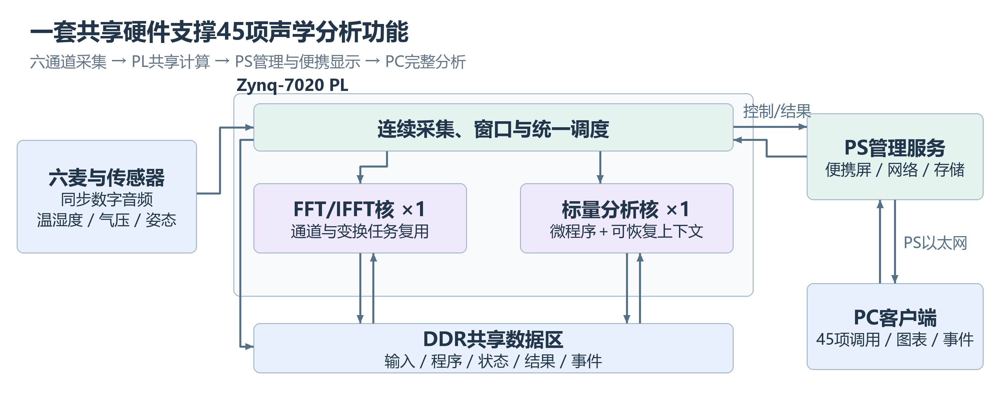
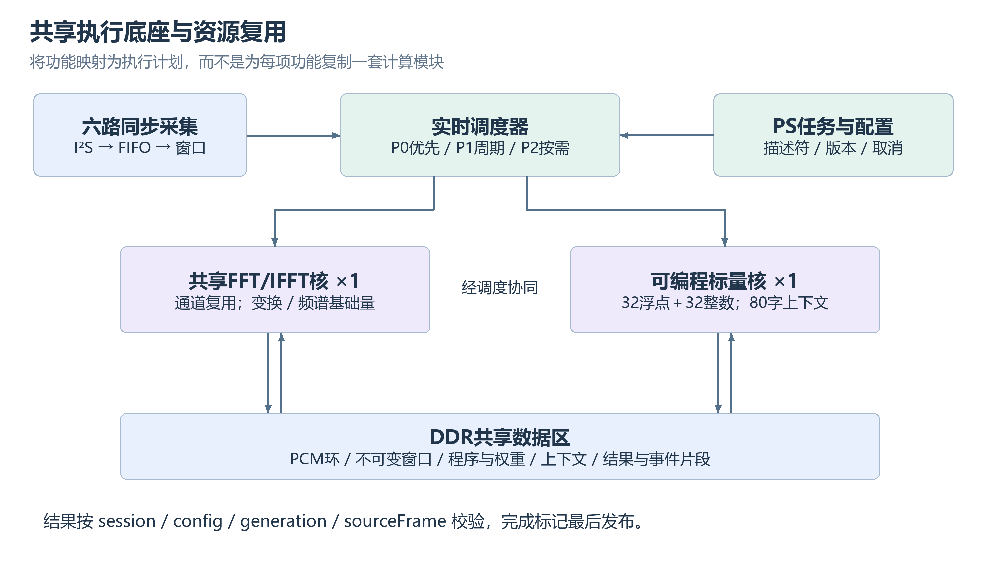
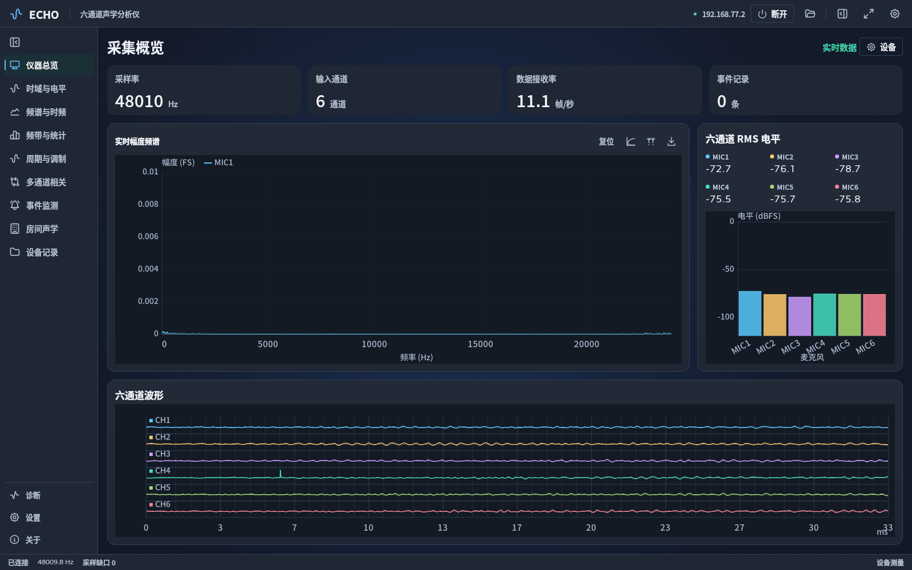
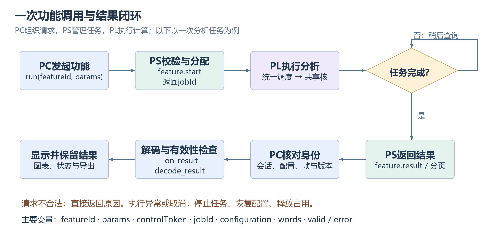

# ECHO · 双核共享六通道声学分析仪

**Heterogeneous Dual-Core Acoustic Analyzer**

基于 **Zynq-7020** 的六通道声学分析作品。通过 **2048 点 FFT/IFFT 专用核 + 可编程标量核** 共享计算资源，以 **P0 实时优先、P1 周期执行、P2 按需运行** 的方式组织 45 项声学分析功能，结合板端触摸显示、Windows 客户端和事件音频记录，形成从声音采集到结果查看与导出的完整工程。

**创新关键词：双核共享计算 · 微程序可编程 · 多优先级协同调度**

[设计报告](report/design_report.md) · [完整复现说明](build/REPRODUCE.md) · [接线与启动](board/README.md) · [45 项功能与证据](report/45项功能与证据.csv) · [软件输入与参考](data/software_measurements/45项输入结果参考索引.csv)



## 目录

- [1. 作品介绍](#1-作品介绍)
- [2. 新手阅读路线](#2-新手阅读路线)
- [3. 架构与创新设计](#3-架构与创新设计)
- [4. 功能范围](#4-功能范围)
- [5. 下载与环境准备](#5-下载与环境准备)
- [6. 不接板学习数据与算法](#6-不接板学习数据与算法)
- [7. 直接运行现成系统](#7-直接运行现成系统)
- [8. 源码阅读指南](#8-源码阅读指南)
- [9. 源码运行与重建](#9-源码运行与重建)
- [10. 性能与验证依据](#10-性能与验证依据)
- [11. 常见问题](#11-常见问题)
- [12. 文档与贡献](#12-文档与贡献)
- [13. 许可证](#13-许可证)

## 1. 作品介绍

ECHO 面向小型设备声音检查、环境声音变化记录以及声学教学实验。例如：观察风扇或电机的主频与谐波变化，对比两次测量的频谱，查看多个通道之间的相干与时延，或在背景学习后记录声音变化及关联音频。

作品围绕三个使用目标展开：

- **测得见**：连续采集六路声音，查看电平、频谱和时频变化。
- **能比较**：观察频带、谐波、调制及通道关系，进行冻结频谱与 A/B 对照。
- **可追溯**：保留事件、原始音频及测量关联信息，在 PC 上查看和导出。

FFT、相关和衰减积分等采用成熟方法；本项目的创新重点是有限 FPGA 资源下的计算复用、任务组织与软硬件协同。

> 本文所称“双核”，指 PL 中的 FFT/IFFT 核与可编程标量核。45 项是活动功能目录数量；多个功能复用同一套计算硬件。

## 2. 新手阅读路线

| 你的目标 | 推荐顺序 |
| --- | --- |
| 快速了解作品 | 第 1、3、4 节 → [设计报告](report/design_report.md) |
| 没有开发板，先学习算法与数据 | 第 6 节 → [输入/参考索引](data/software_measurements/45项输入结果参考索引.csv) → 第 8 节 |
| 已有同型号硬件，直接运行 | 第 5 节下载 → 第 7 节接线、SD 启动和 PC 连接 |
| 修改 Windows 客户端 | 第 8.2 节 → 第 9.1 节 |
| 修改 PS 网关或板端界面 | 第 8.3 节 → 第 9.2 节 |
| 修改 PL、HLS 或微程序 | 第 8.4 节 → 第 9.3 节，并核对启动文件匹配关系 |
| 查看性能和验证依据 | 第 10 节 → `build/vivado_evidence/`、`board/evidence/`、`sim/inherited_results/` |

## 3. 架构与创新设计

### 3.1 PC / PS / PL 分层

| 层级 | 主要职责 | 主要源码位置 |
| --- | --- | --- |
| PL：FPGA 逻辑 | 六通道采集、窗口搬运、FFT/IFFT、标量运算、调度及状态 | `src/project/deployment/work_platform_20261013/phase15_analysis_only_20261023/` |
| PS：ARM/Linux | MMIO 访问、功能参数映射、任务管理、网络、板端界面与文件存储 | `src/project/deployment/echo_interface_guard_20261026/`、`echo_live_fix_20261026/` |
| PC：Windows 客户端 | 功能控制、协议解码、图表展示、数据导出及交互 | `src/project/apps/sixmic-desktop/` |

声音从 INMP441 进入 PL，经窗口和计算后形成结果；PS 将功能调用映射为设备执行计划并转发结果，PC 负责显示。原始 PCM 同时进入录音缓存，用于记录和事件片段保存。

### 3.2 双核共享计算

- **FFT/IFFT 专用核**承担结构固定的变换计算。PCM 前处理包括去均值与 Hann 窗，输出频谱、功率谱、PSD 及基础电平等数据。
- **可编程标量核**执行浮点运算、索引、条件跳转与 DDR 访存。37 项微程序功能路径复用此核，实现频带统计、谱特征和相关后处理等。
- **实时采集与调度链**持续提供输入、管理窗口和执行机会，与两个计算核协作。

这种组织将许多功能差异放到微程序、参数和执行计划中，减少硬件重复。新增功能仍需核对指令能力、内存布局、任务计划、PS 路由与 PC 结果解析。

### 3.3 多优先级与可恢复执行

| 等级 | 运行方式 | 代表功能 |
| --- | --- | --- |
| P0 | 实时优先，持续采集与基础发布 | PCM、电平、FFT、STFT、输入状态 |
| P1 | 周期运行，共享计算资源 | 倍频程、谱平滑、主频跟踪、相干与计权 |
| P2 | 按需启动，可包含多阶段处理 | 包络、相关、倒谱、房间衰减、实验 STIPA |

较长的标量任务可以在有界执行批次后保存现场，再继续运行。当前单次执行预算最多为 **512 条指令**，表示一次调度的工作量；完整算法可以跨多个批次执行。采集持续进行，共享任务按计划获得执行机会。



## 4. 功能范围

当前活动目录为 **45 项、7 类**。具体 `featureId`、调度等级、生产者及验收字段见 [功能与证据清单](report/45项功能与证据.csv)。

| 功能组 | 数量 | 内容 |
| --- | ---: | --- |
| 采集与电平 | 5 | 六通道 WAV/PCM、RMS/Peak/dBFS、扩展电平、采样连续性、输入质量 |
| 频谱与比较 | 9 | FFT、Welch PSD、STFT、谱平均、峰值保持、平滑、Zoom FFT、频谱冻结与 A/B、相对限值 |
| 频带与计权 | 5 | 1/1 与 1/3 倍频程、A/C/Z 与 FAST/SLOW、电平统计、NC/NR 估计 |
| 多通道关系 | 5 | CSD/CSM、相干与相位差、自相关、互相关、GCC-PHAT 时延观察 |
| 周期与调制 | 12 | 主频跟踪、频漂、谱质心、平坦度、谱峭度有限原型、实倒谱、基频、谐波比、边带、Hilbert 包络、包络谱、调制谱 |
| 房间声学 | 5 | EDT/T20/T30、C50/C80/D50、分频衰减、相对隔声、实验 STIPA |
| 变化与事件 | 4 | 短时能量变化、频带能量跟踪、谱通量、声音变化事件服务 |

使用结果时注意单位与有效性：`dBFS` 是相对数字满量程；绝对声压级需要对应校准。相对隔声、NC/NR 估计和实验 STIPA 应按各自适用条件解释。GCC-PHAT 在当前功能中用于时延观察；当前交付已停用六项空间功能。

## 5. 下载与环境准备

### 5.1 推荐使用 Git + Git LFS

先安装 Git 和 Git LFS，再执行：

```powershell
git lfs install
git clone https://github.com/anaklies/Heterogeneous-Dual-Core-Acoustic-Analyzer.git
cd Heterogeneous-Dual-Core-Acoustic-Analyzer
git lfs pull
git lfs ls-files
```

仓库通过 Git LFS 管理以下大文件：

- `board/project/recoverable_project.zip`：可恢复 Vivado 工程。
- `board/sd/image.ub`：Linux/FIT 启动基线。
- `build/deps/arm_sysroot.zip`：ARM 编译依赖。
- `src/pl_project/instrument_board.srcs/utils_1/imports/synth_1/design_1_wrapper.dcp`：工程检查点。

如果文件内容以 `version https://git-lfs.github.com/spec/v1` 开头，拿到的是 LFS 指针，需要完成实际文件下载。直接下载 GitHub ZIP 时也要检查上述文件是否为实际内容。

### 5.2 按目标准备环境

| 使用目标 | 所需环境 |
| --- | --- |
| 阅读源码与查看已有数据 | 文本编辑器、CSV/JSON 查看工具；播放 WAV 可使用音频软件 |
| 运行交付的 PC 客户端 | Windows 10/11 x64、完整 `board/pc/echo/` 目录 |
| 重新生成软件参考数据 | Python 3.12、`sim/software_data_requirements.txt` 中的依赖；原生 DLL 依赖 Windows 环境 |
| 修改或打包 PC | Python 3.12、PC 锁定依赖；PySide6 / Qt Quick / QML 与打包工具由依赖文件约束 |
| 重建 PS | Vitis 2025.2 的 AArch32 ARM Linux 编译器及随包 sysroot |
| 重建 PL / HLS / BOOT | Vivado / Vitis 2025.2，目标 `xc7z020clg484-2`，相应器件支持与 IP 使用条件 |
| 真实板端运行 | RK-ZYNQ7020-F、配套六麦接线、SD 卡、电源、PS 网口连接；本地触摸操作另需配套显示与 USB 触摸连接 |

建议使用短的英文工程路径，例如 `D:/ECHO/`。以下命令除特别说明外，均在仓库根目录运行；`D:/2025.2/` 请替换为实际工具安装路径。

## 6. 不接板学习数据与算法

### 6.1 查看已有数据

打开 [45 项输入结果参考索引](data/software_measurements/45项输入结果参考索引.csv)，按 `featureId` 找到对应输入、参考和实际软件输出目录。

| 路径 | 内容 |
| --- | --- |
| `data/software_measurements/inputs/` | 确定性输入 WAV，包括单音、双音、噪声、调幅、谐波、时延与衰减等 |
| `data/software_measurements/reference/` | 各功能的参考结果 |
| `data/software_measurements/native/` | 原生执行内核的软件输出与比较结果 |
| `data/software_measurements/inherited/` | 继承结果 |
| [SUMMARY.json](data/software_measurements/SUMMARY.json) | 数据规模、依赖版本、测试组与证据范围 |

建议先学习三组容易理解的例子：

1. **单音 → FFT / 电平**：查看 1 kHz 输入，对照峰值频率和幅值定义。
2. **已知延迟双通道 → 相关**：查看 7 个采样点延迟的宽带输入，理解相关峰位置与正负号约定。
3. **理想衰减 → 房间指标**：查看理想 RT60 为 0.4 s 的输入，理解衰减曲线和拟合区间。

索引中的证据类型决定能得出什么结论：`NATIVE_CORE_PAIR` 表示内核软件输出与参考的配对；`REFERENCE_FIXTURE` 表示参考夹具；`CONTROL_FIXTURE_NOT_END_TO_END` 表示流程夹具。现有汇总记录为 **11 个 WAV、45 项索引、6 组原生软件测试、92 项捕获用例**，与完整板级验收分别记录。

### 6.2 需要时重新生成

在工程副本中操作，保留原始参考用于比较：

```powershell
python -m venv .venv-data
.\.venv-data\Scripts\python.exe -m pip install -r sim/software_data_requirements.txt
.\.venv-data\Scripts\python.exe -X utf8 sim/generate_software_measurements.py
```

生成脚本会写回 `data/software_measurements/`。其中运行的原生 DLL 用于软件数值验证，不能据此推断 FPGA 的执行周期。当前 PC 产品客户端面向设备工作流；上述 WAV 的学习与参考验证通过数据和脚本进行。

## 7. 直接运行现成系统

### 7.1 接线与 SD 启动

本交付使用独立麦克风外部时钟线版本：每个 INMP441 的 SD、SCK、WS 分别接入 J1，PL 内部由同一同步源驱动六组时钟。SHT30 与 IMU 使用独立 I²C 支路。

完整引脚、供电与方向见 [WIRING.md](board/config/WIRING.md) 和 [NEW_PINS.json](board/config/NEW_PINS.json)。麦克风使用 **3.3 V、公共地、L/R 接地**；J1 第 2 脚为 **5 V**，不能接麦克风电源。先核对接线版本与 BOOT/Bitstream，再上电。

1. 备份已有 SD 卡内容，准备 FAT32 启动分区。
2. 将 `board/sd/` 中的**全部文件**复制到分区根目录，包括 `BOOT.BIN`、`image.ub`、`system.dtb`、`boot.scr` 及版本文件。
3. 按 [板卡说明](board/README.md) 和对应硬件手册，断电设置 SD 启动模式后上电。
4. 如启动异常，通过 DEBUG 串口 **115200、8N1** 查看日志。

保持整组启动文件匹配。此 SD 恢复流程不写入 QSPI/eMMC。

### 7.2 PC 连接

连接开发板的 **PS 网口**与电脑，并为电脑所接网卡配置同一网段：

| 项目 | 配置 |
| --- | --- |
| PC 网卡 IPv4 | `192.168.77.1` |
| 子网掩码 | `255.255.255.0`，即 `/24` |
| 设备 IPv4 | `192.168.77.2` |
| 控制通道 | TCP `48120` |
| 二进制数据通道 | TCP `48121` |

双击 `board/pc/echo/echo.exe`，在连接界面连接设备。保留整个 `echo/` 目录，程序依赖旁边的 Qt、资源与协议文件。

可用以下命令辅助检查端口：

```powershell
Test-NetConnection 192.168.77.2 -Port 48120
Test-NetConnection 192.168.77.2 -Port 48121
```

端口连通后，再通过客户端确认设备状态、数据更新与结果有效性。

### 7.3 第一次测量

1. **看六路输入**：在总览查看电平与频谱，确认各路有随声音变化的输入。
2. **看已知频率**：播放约 1 kHz 声音，检查频谱峰位置；扬声器与房间响应会影响幅度和谐波。
3. **启动一个周期功能**：观察结果持续更新，再停止任务并查看保留图表。
4. **尝试事件记录**：启动背景学习，完成后制造明显声音变化，查看事件及下载音频。
5. **再做专门实验**：房间衰减、隔声、STIPA 等按对应界面的激励与参考流程运行，结合有效性字段解释结果。



## 8. 源码阅读指南

### 8.1 目录地图

```text
.
├─ src/
│  ├─ project/              # 保留原相对依赖的研发源码树
│  │  ├─ apps/sixmic-desktop/     # PC：Python、QML、协议客户端与测试
│  │  ├─ deployment/             # PL/HLS、微程序、PS 网关与板端应用
│  │  └─ interfaces/pc_backend_v1/ # 网络协议、MMIO、DTO 与黄金样例
│  └─ pl_project/           # 恢复物理实现工程时覆盖使用的源文件
├─ board/                  # SD 启动、PC 程序、PS 二进制、Bitstream/XSA
│  ├─ config/              # 接线与发布配置
│  ├─ project/             # Vivado 可恢复工程（LFS）
│  └─ evidence/            # 部署与板端记录
├─ build/                  # 统一重建入口、工具参数与实现报告
├─ sim/                    # 软件数据生成、PC 测试入口与继承验证结果
├─ data/                   # 输入、软件输出与参考
├─ report/                 # 设计报告、功能清单、配图与协作记录
└─ skill/                  # 从本项目提炼的可复用工程方法
```

`deployment/` 中的日期目录保留了研发和修复来源。先跟随当前入口与构建脚本阅读；历史文档中的功能数量、分片预算和开发机绝对路径需要结合版本理解。当前活动目录为 45 项，旧说明中的 51/52 项、64 指令预算属于历史记录。

### 8.2 PC：从界面向下阅读

从 [main.py](src/project/apps/sixmic-desktop/main.py) 开始，它连接后端与 Qt Quick 界面。随后按职责阅读：

| 位置 | 重点 |
| --- | --- |
| `src/project/apps/sixmic-desktop/ui/qml/` | 页面、图表、组件与交互 |
| `src/project/apps/sixmic-desktop/ui/viewmodels/` | 界面状态、功能结果解码与显示数据 |
| `src/project/apps/sixmic-desktop/backend/` | 后端、协议和设备数据处理 |
| `src/project/apps/sixmic-desktop/pc_client/` | 客户端相关代码 |
| `src/project/apps/sixmic-desktop/tests/` | 协议、后端及界面相关测试 |

修改图表时，先追踪它使用的结果字段与单位，再改显示。修改测量调用时，还需检查参数、任务生命周期及设备返回状态。

### 8.3 PS：从接口追到网关

先看 [网络协议](src/project/interfaces/pc_backend_v1/PROTOCOL.md)、[DTO 定义](src/project/interfaces/pc_backend_v1/dto/DTO.md) 与 [MMIO 协议](src/project/interfaces/pc_backend_v1/device/MMIO_PROTOCOL3.md)，再看：

- [活动接口注册表](src/project/deployment/echo_interface_guard_20261026/registry/INTERFACE_REGISTRY.json)：按 `featureId` 找参数、输入要求、生产者与状态。
- `src/project/deployment/echo_interface_guard_20261026/gateway/src/`：控制与数据服务、路由、任务执行和 MMIO。
- `src/project/deployment/echo_live_fix_20261026/app/`：板端应用；实际编译来源以 `build/recorded_commands/` 为准。
- `src/project/deployment/echo_spatial_off_20261031/`：最终空间功能停用及镜像补丁记录。

网络协议版本 1 与 MMIO 版本 3 分别对应网络层和板内接口。控制通道采用 JSON-Lines，数据通道采用二进制帧；字段、单位或枚举变化时，需要同步核对 PS 与 PC。

### 8.4 PL：从顶层追到计算核

以下以 `src/project/deployment/work_platform_20261013/phase15_analysis_only_20261023/` 为基础路径：

| 相对路径 | 建议阅读内容 |
| --- | --- |
| `integration/instrument_top.sv` | 系统顶层与模块连接 |
| `integration/pcm_capture.sv`、`integration/sample_cdc.sv` | PCM 采集与时钟域跨越 |
| `integration/window_dma.sv`、`integration/window_pool.sv` | 分析窗口搬运与管理 |
| `integration/analysis_scheduler.sv`、`integration/analysis_runtime.sv` | 调度与执行状态 |
| `integration/shared_backend/stream_fft.cpp` | FFT/IFFT 与 PCM 前后处理 |
| `integration/shared_backend/scalar_engine.cpp` | 标量指令、寄存器、访存与上下文 |
| `integration/services/` | 微程序构建、计算链与数值测试 |
| `integration/host/service_result.c` | 主机侧服务结果读取 |

例如学习谱平滑，可以追踪 `smoothing` 注册项 → PS 路由 → `services/programs.py` → `scalar_engine.cpp` → 结果读取 → PC 解码与图表。查看 `services/` 中的 Python 时，要区分微程序生成、参考计算和测试代码，结合网关与执行核判断实际运算位置。

`src/pl_project/` 保存恢复 Vivado 物理实现所需的对应源树。PL 重建使用恢复工程和这份覆盖树；修改研发树中的文件后，需同步核对构建实际采用的文件与 IP。

### 8.5 一次调用需要检查什么

```text
PC 选择 featureId 与参数
  → 后端经 TCP 48120 提交控制请求
  → PS 查注册表、准备输入、装载执行计划
  → MMIO / DDR → PL 调度与计算
  → PS 检查完成状态并读取结果
  → TCP 48121 / 控制响应 → PC 解码、图表与导出
```

沿途关注 `jobId`、`session`、`config`、`generation`、`sourceFrame` 和 `valid`，防止旧任务或旧窗口结果进入当前显示。多阶段任务还要区分阶段索引与已完成阶段数，并单独检查最终有效性。



## 9. 源码运行与重建

完整版本与操作边界见 [REPRODUCE.md](build/REPRODUCE.md)。建议先在工程副本中复现未修改版本，再改动单个模块。

### 9.1 PC：启动、测试与打包

```powershell
python -m venv .venv-pc
.\.venv-pc\Scripts\python.exe -m pip install -r src/project/apps/sixmic-desktop/packaging/requirements-lock.txt
```

运行后端自检与源码界面，显式使用随包协议目录：

```powershell
.\.venv-pc\Scripts\python.exe src/project/apps/sixmic-desktop/main.py --self-test --protocol-dir src/project/interfaces/pc_backend_v1
.\.venv-pc\Scripts\python.exe src/project/apps/sixmic-desktop/main.py --protocol-dir src/project/interfaces/pc_backend_v1
```

运行 PC 测试或打包：

```powershell
powershell -ExecutionPolicy Bypass -File sim/run_pc_tests.ps1 -PythonExecutable "$PWD/.venv-pc/Scripts/python.exe"
powershell -ExecutionPolicy Bypass -File build/rebuild_pc.ps1 -PythonExecutable "$PWD/.venv-pc/Scripts/python.exe"
```

打包输出位于 `build/out/pc/`。源码界面启动、自检和设备测量分别验证；实际测量还需连接板卡。

### 9.2 PS：ARM 网关与板端应用

先检查编译命令与源码路径，再执行交叉编译：

```powershell
python -X utf8 build/rebuild_ps.py --toolchain-bin D:/2025.2/Vitis/gnu/aarch32/nt/gcc-arm-linux-gnueabi/bin --dry-run
python -X utf8 build/rebuild_ps.py --toolchain-bin D:/2025.2/Vitis/gnu/aarch32/nt/gcc-arm-linux-gnueabi/bin
```

脚本根据 `build/recorded_commands/` 重定位路径，并使用随包 ARM sysroot。输出位于 `src/project/deployment/*/build/arm/` 对应目录。`--dry-run` 检查命令与源码路径；实际编译还需可用的编译器和依赖。

`board/ps/bin/` 是最终交付镜像提取出的程序。新编译结果需要单独验证，再显式组装到新的镜像路径。镜像工具的参数与只读检查入口为：

```powershell
python -X utf8 build/assemble_ps_image.py --help
python -X utf8 build/assemble_ps_image.py --inspect
```

### 9.3 PL：恢复工程并重建

```powershell
powershell -ExecutionPolicy Bypass -File build/rebuild_pl.ps1 -Vivado D:/2025.2/Vivado/bin/vivado.bat
```

该入口将恢复工程解压到 `build/work/pl/`，覆盖匹配的 `src/pl_project/` 源文件，再综合与实现，输出至 `build/out/pl/`。已有工作目录时脚本会停止，保留上一次构建。

若改动 HLS C/C++ 核，先生成可重定位配置：

```powershell
python -X utf8 build/prepare_hls_configs.py
```

随后使用 Vitis 2025.2 运行对应组件、导出新 IP，并在恢复工程中更新。仅修改 HLS 源文件后重新综合旧 IP，不会自动包含这些改动。

本重建入口会检查实现、已检查路径的最差 Slack 与 DRC。当前报告仍有外部输入/输出 delay 约束缺口，结果范围见第 10 节。

### 9.4 BOOT 与部署文件匹配

```powershell
powershell -ExecutionPolicy Bypass -File build/rebuild_boot.ps1 -Bootgen D:/2025.2/Vitis/bin/bootgen.bat
```

默认使用 `board/boot_components/` 中的组件，输出 `build/out/boot/BOOT.BIN`。该命令不会自动采用 `build/out/pl/` 的新 Bitstream。修改 PL 后，应在工作副本中明确更新启动组件，并检查 XSA、FSBL、设备树与 PS/PL 接口是否匹配。

| 改动内容 | 部署时要核对 |
| --- | --- |
| PC 界面或解码 | 新 PC 程序与现有 PS 协议、字段和单位兼容 |
| PS 路由、任务管理、板端界面 | 新 ARM 程序、注册表及 FIT 镜像内容匹配 |
| 微程序、参数或执行计划 | 指令能力、数据布局、程序/计划与网关配置一致；是否需新 Bitstream 取决于硬件是否改变 |
| HLS、RTL、MMIO 或接线 | 新 IP/Bitstream、BOOT、XSA 相关组件及软件接口匹配 |

本仓库提供厂商 Linux/FIT 二进制基线与自研部分的重建入口。完整厂商 Kernel、U-Boot、FSBL 源码和 BSP 未全部包含；全系统从源码重建需要另行准备匹配版本。

## 10. 性能与验证依据

### 10.1 平台与实现数据

| 项目 | 当前报告数据 |
| --- | --- |
| 平台 | RK-ZYNQ7020-F / XC7Z020-2CLG484 |
| 采集 | 6 路、24-bit，实际采样率约 48009.775 Hz |
| PL 分析时钟 | 50 MHz |
| FFT 点数 / 频率间隔 | 2048 / 约 23.442 Hz |
| LUT | 40127 / 53200，约 75.43% |
| FF | 42117 / 106400，约 39.58% |
| DSP48 | 88 / 220，40.00% |
| BRAM36 等效 | 57.5 / 140，约 41.07% |
| 已约束路径时序 | WNS +0.149 ns、WHS +0.036 ns；TNS/THS 为 0 |
| DRC | 错误级违规 0 |

资源和时序来源见 `build/vivado_evidence/` 与 `board/config/RELEASE.json`。当前报告存在 **10 个输入、20 个输出 delay 约束缺口**；上述时序结论限定于已约束路径。

### 10.2 同 Bitstream 的调度预算优化

将单次标量执行预算从 **64 条增加到 512 条**，减少重复提交与上下文保存开销。在同 Bitstream、固定输入的目标板配对测试中：

| 代表任务 | 基线执行时间 / ms | 优化执行时间 / ms | 降低 |
| --- | ---: | ---: | ---: |
| 谱平滑 | 54.891 | 46.243 | 15.76% |
| 1/3 倍频程 | 8.854 | 5.859 | 33.83% |
| A 加权电平 | 45.309 | 11.471 | 74.68% |
| 互谱 / 相干 / 相位 | 53.051 | 44.291 | 16.51% |
| 实倒谱 | 223.295 | 141.821 | 36.49% |
| GCC-PHAT | 815.921 | 559.105 | 31.48% |
| 房间衰减 / 清晰度 | 2142.296 | 1414.058 | 33.99% |

共 **7 组、28 次配对调用**，比较的 **26372 个输出字逐字一致**，LUT/FF/DSP/BRAM 增量为 0。表中是执行阶段中位时间，不包含采集、计划加载或 PC 显示。

历史 P0 测试记录发布率约 **11.721 Hz**、最大处理时间约 **27.205 ms**，适用于相应测试条件。各功能的窗口需求与执行时间不同，刷新率应分别评估。

原始记录：`sim/inherited_results/performance_resource_comprehensive_20261025/`；整理材料：`build/vivado_evidence/performance/`。

### 10.3 如何理解验证状态

| 证据 | 支持的判断 |
| --- | --- |
| 输入 WAV 与参考 JSON | 输入与预期数学结果可查 |
| 原生内核软件配对 | 对应内核在给定软件测试中的数值一致性 |
| RTL / HLS 仿真 | 对应版本、输入和覆盖范围内的行为 |
| Vivado 实现报告 | 对应工程的资源、已约束时序与 DRC 状态 |
| 部署记录 | 固件、注册表及设备接口的部署情况 |
| 真实板测 | 对应任务、输入、版本与条件下的板端结果 |

[45 项功能与证据](report/45项功能与证据.csv) 保留原始 `hardwareAccepted` 字段。目录存在、软件参考通过和完整实物声学验收是不同层次，应结合每项证据判断当前状态。

## 11. 常见问题

| 现象 | 优先检查 |
| --- | --- |
| `image.ub` 很小，恢复工程 ZIP 无法解压 | 是否只下载了 Git LFS 指针；运行 `git lfs pull` |
| PC 程序启动失败或缺少 Qt 组件 | 是否保留完整 `board/pc/echo/` 目录、资源与运行依赖 |
| 设备连接不上 | PS 网口链路、电脑网卡 IP、设备启动日志、防火墙及 48120/48121 服务 |
| 能连接但图表不更新 | 任务状态、当前功能、结果 `valid`、输入新鲜度及 session/config/generation 是否匹配 |
| 某路没有声音 | 该路供电、地、L/R 与 SD/SCK/WS 接线，以及接线和 Bitstream 版本 |
| 新 HLS 代码没有影响硬件行为 | 新 IP 是否已导出、更新到 Vivado，并部署了对应新 BOOT |
| 修改微程序后结果仍旧 | 实际加载的程序、执行计划、注册表及镜像是否已更新 |
| 房间声学任务完成但结果无效 | 激励、参考、记录长度、拟合区间与结果有效性说明 |
| 旧文档显示 51/52 项功能 | 查看当前 45 项注册表及最终部署记录，结合历史版本阅读 |
| 交付哈希检查报告缺文件或不同 | 核对清单所属快照、上传后的文件改名及本地修改；原交付清单不能直接当作当前 Git 提交的完整清单 |

## 12. 文档与贡献

- [设计报告](report/design_report.md)：应用背景、架构、设计取舍与验证结果。
- [完整复现说明](build/REPRODUCE.md)：PL、PS、PC 和启动文件的构建入口。
- [板卡说明](board/README.md)：接线、SD 启动、连接与恢复。
- [接口契约](src/project/interfaces/pc_backend_v1/PROTOCOL.md)：PC/PS 通信定义。
- [协作记录](report/ai_collaboration_record.md)：设计协作、核查与纠错过程。
- [可复用技能包](skill/README.md)：证据校验、有界 FPGA 优化及分层功能排查方法。

欢迎通过 Issue 反馈问题，或通过 Pull Request 提交改进。复现问题时请附上所用提交版本、工具版本、启动/接线版本、操作步骤、输入和相关日志。更改算法或接口时，请提供受影响功能的数值比较或设备测试记录，并明确测试范围。

## 13. 许可证

本仓库根目录采用 [MIT License](LICENSE)。第三方 IP、库、字体、厂商启动组件及工具链仍遵循各自许可证；具体使用与再分发需保留相应声明并核对授权条件。

## English Overview

ECHO is a six-channel acoustic analyzer built on a Zynq-7020. A shared 2048-point FFT/IFFT core and a programmable scalar core support 45 functions through prioritized scheduling. The PL performs acquisition and acoustic computation, the ARM/Linux PS manages tasks, networking and storage, and a Windows client provides visualization and export.

The repository includes source code, software references, build entry points, a recoverable Vivado project, an SD boot baseline and validation records. Start with the source map in Section 8 or [build/REPRODUCE.md](build/REPRODUCE.md). Git LFS is required for key large files. Software reference coverage, deployment records and physical-board acceptance are documented separately.
