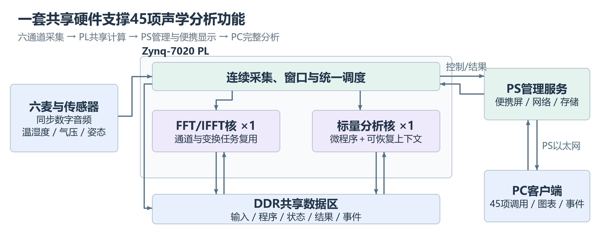
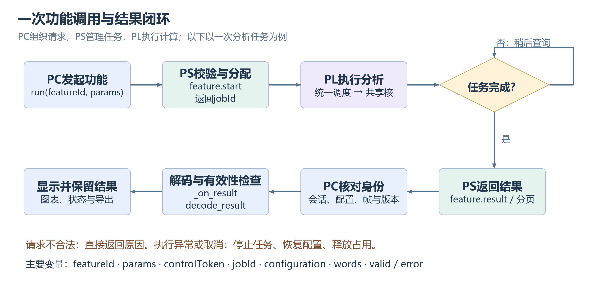
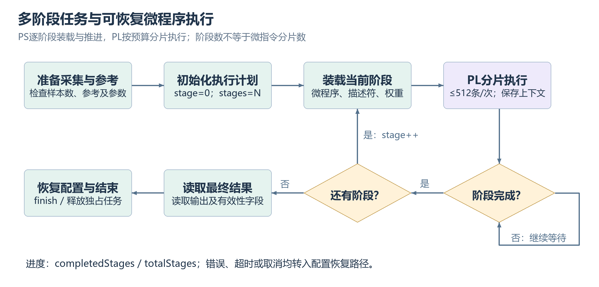
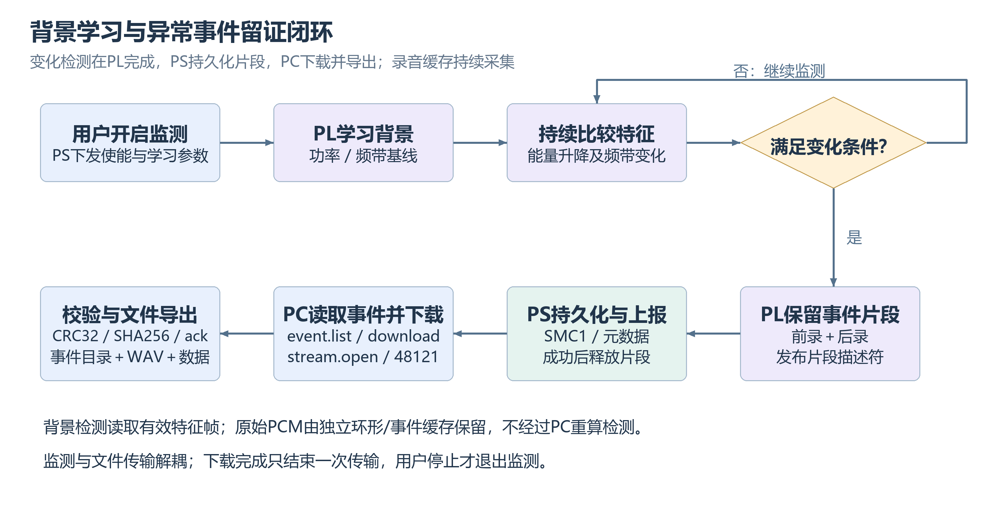
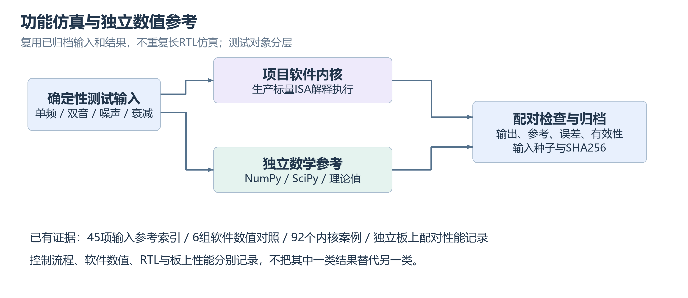
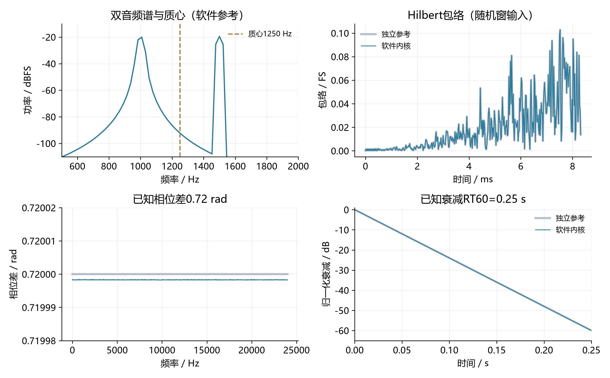
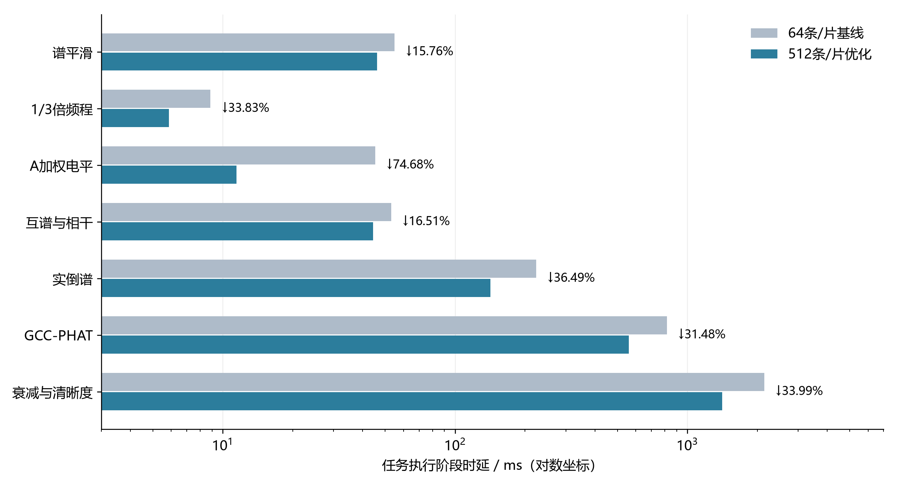
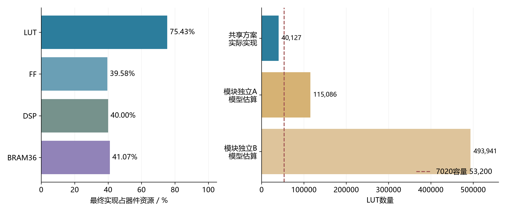

#双核共享六通道声学分析仪设计报告

作品以一套FFT/IFFT专用模块和一套可编程标量核，复用多种声学计算；用P0优先、P1周期、P2按需的调度组织测量，结合六通道采集、便携显示和事件音频留存，形成可恢复的完整仪器。

## 1 选题背景与应用价值

风扇、电机、机柜等设备的声音变化，以及宿舍、教室和办公室中的频谱差异，经常需要同时观察电平、频带、谐波和事件发生前后的数据。单一手机应用便于查看声音，却难以提供本项目所需的六通道同步输入、板端统一计算和事件前后片段关联。大型专业系统功能丰富，但其成本和使用复杂度不适合本次便携学生作品。

本设计将重点放在“测得见、能比较、可追溯”：持续观察六路声音；按需分析频谱与多通道关系；对声音变化记录事件和音频；通过小屏完成便携操作，在PC上查看更完整的图表及导出数据。房间声学作为实验功能，配合明确的参考与激励流程。

FFT、PSD、相关和衰减积分属于成熟方法。作品的主要创新在系统组织：在资源有限的7020上，将大量功能差异转化为微程序与参数，通过专用变换核、可恢复标量核和共享存储协同执行，避免为每个功能复制完整计算链。

| 应用 | 操作及产出 |
| --- | --- |
| 小型设备声音检查 | 电平、主频、谐波、边带及正常/变化频谱对照 |
| 环境声音变化记录 | 学习背景后监测变化，保存前后音频与关联数据 |
| 教学与声学实验 | 查看时频、互谱、相干、时延和房间衰减等结果 |
| 便携检查与桌面分析 | 小屏快速查看，PS网口连接PC进行详细操作 |

## 2 功能范围与产品组织

活动功能目录共45项、7类。完整名称、featureId、生产者和原始验收字段在“45项功能与证据.csv”

| 功能组 | 数量 | 具体功能 |
| --- | --- | --- |
| 采集与电平 | 5 | PCM、电平核心、扩展电平、采样连续性、输入质量 |
| 频谱与比较 | 9 | FFT、PSD、STFT、谱平均、峰值保持、平滑、Zoom FFT、频谱冻结、相对限值 |
| 频带与计权 | 5 | 倍频程、1/3倍频程、频率/时间计权、电平统计、NC/NR |
| 多通道关系 | 5 | CSD、相干/相位、自相关、互相关、GCC-PHAT |
| 周期与调制 | 12 | 主频跟踪、频漂、质心、平坦度、谱峭度、倒谱、基频、谐波比、边带、Hilbert包络、包络谱、调制谱 |
| 房间声学 | 5 | 房间衰减、清晰度、分频衰减、相对隔声、实验STIPA |
| 变化与事件 | 4 | 能量变化、频带跟踪、谱通量、事件监测 |

功能运行方式依据数据需求区分：总览持续读取基础结果；周期功能复用最新有效窗口

## 3 系统架构与硬件设计

六个INMP441以24-bit I²S输入PL。各麦克风的SD、SCK、WS在板外分别走线，PL内部由同一时序源驱动；异步FIFO将数据送入分析域。PCM分成原始录音缓存与分析窗口两条路径。窗口、频谱、中间量与结果通过相应内存通路访问外部DDR。

主控为RK-ZYNQ7020-F，器件XC7Z020-2CLG484，PL分析时钟50MHz。实际采样率约48009.775Hz，2048点频率间隔约23.442Hz。SHT30和IMU使用分开的I²C支路，温湿度、气压及估计声速作为设备状态及测量元信息。HDMI连接7英寸1024×600显示屏，USB接收触摸，PS网口连接PC。接线表见board/config/WIRING.md。

### 3.1 专用变换核与可编程标量核

变换模块支持2048点实数PCM前处理、复数FFT及归一化IFFT。PCM模式包含去均值、周期Hann窗及输出后处理，可直接产生幅度谱、功率谱、PSD与基础电平；STFT由连续窗口的频谱及时间戳组成，无须再复制独立变换核心。多个窗口平均等扩展统计由相应流程完成。

标量核采用自定义指令，包含浮点加减乘除、平方根、自然对数、指数、最值与绝对值，以及整数索引、条件跳转和DDR访存。32个浮点及32个整数寄存器保存工作值；单次最多执行512条指令，程序本身可含循环。80个32位字的上下文保存寄存器、下一指令及任务身份，可恢复长任务。37项微程序功能路径复用该核。

512条是单次调度预算，不是算法数量或完整算法长度，也不等于512个时钟。暂停期间大数组仍在DDR，调度必须保持输入及中间量有效。标量核能够按程序读取已有结果，但没有自动识别重复输入并缓存答案的能力。

### 3.2 资源共享与任务调度依据

为每个功能独立配置变换、统计和访存硬件会造成重复开销。这里将结构固定且计算密集的FFT/IFFT保留为专用核，把大量不同公式放入标量微程序。共享核降低硬件复制，代价是功能之间需要合理排队，不能承诺所有功能同时独占最高刷新率。

P0优先保持基础分析发布，P1按周期执行，P2按需启动较长任务。长标量计算在有界批次结束时保存现场，后续继续；遇到变换请求则由协同控制安排FFT/IFFT。上下文机制为调度提供条件，不等于任意时刻抢占。

## 4 软硬件划分与接口

| 位置 | 职责 | 选择依据 |
| --- | --- | --- |
| PL | 采集、变换、声学计算、事件特征判断、调度及状态 | 统一采样与计算，复用硬件，保留设备独立工作基础 |
| PS | MMIO、任务网关、小屏、网络、文件与事件存储 | 适合系统管理及操作系统服务，不承担声学重算 |
| PC | 功能控制、解码、图表、导出与交互 | 利用桌面显示能力，不以主机计算冒充PL结果 |

PC控制通道为TCP48120，二进制数据为48121；PS/PL使用版本3 MMIO，配置与结果通过版本及身份字段关联。PC按featureId调用，网关将功能参数映射为设备执行计划。外部功能接口与内部运算调度分离，保持接口契约时，内部优化无需重写PC。

主要变量包括featureId、jobId、session、config、generation、sourceFrame、sample时间计数及结果valid。网关检查输入长度和偏移、准备数据、装载程序、启动PL并轮询状态；完成后读取结果并解码。PC仅呈现有效且属于当前任务的数据。

多阶段任务按执行计划逐段运行，阶段结束后检查结果再进入下一阶段。currentStageIndex从0开始，completedStages表示已完成数量，两者不能混用；进度条完成也不能代替最终结果有效。结束及取消都需处理资源释放和配置恢复。

事件检测利用六路电平和频带摘要学习背景，再检测能量上升、规律声音中断和频带变化；原始PCM走并行缓存路径。

## 5 功能正确性与验证设计

采用分层验证：先明确数学定义与输入，再比较软件参考与执行内核；RTL验证握手、状态及存储；板测记录设备周期和接口输出

| 证据 | 数量或范围 | 能支持的结论 |
| --- | --- | --- |
| 软件输入及参考 | 11个WAV、45项索引 | 具备可复现输入与预期结果，不等于全部板测 |
| 原生软件执行 | 6组测试、92项用例 | 对应内核实际输出与黄金比较 |
| 继承RTL和实现报告 | 源树测试及已布线报告 | 在原版本及输入范围内继承 |
| 最终板端部署 | 10月31日45项目录及部署记录 | 软件/接口版本和部署证据 |
| 目标7020优化板测 | 7组、28次配对调用 | 对应任务执行阶段加速及结果一致 |

数据按NATIVE_CORE_PAIR、REFERENCE_FIXTURE、流程夹具及继承结果分别标识。FFT幅度、功率、PSD单位分别处理；CSD共轭顺序、单边谱系数、窗函数缩放与实际采样率均需一致。

## 6 性能与资源优化过程

### 6.1 优化选择及结果

首先观察共享执行的提交和上下文开销。谱平滑程序需执行12289条动态指令，原64条预算导致193次调用；将单次预算改为512后降为25次，少168次上下文写回。按每次320字节计算，减少53760字节现场写回。该修改保留程序、输入、计算顺序和Bitstream，优先减少控制开销。

| 任务 | 基线ms | 优化ms | 降低 |
| --- | --- | --- | --- |
| 谱平滑 | 54.891 | 46.243 | 15.76% |
| 1/3倍频程 | 8.854 | 5.859 | 33.83% |
| A加权电平 | 45.309 | 11.471 | 74.68% |
| 互谱/相干/相位 | 53.051 | 44.291 | 16.51% |
| 实倒谱 | 223.295 | 141.821 | 36.49% |
| GCC-PHAT | 815.921 | 559.105 | 31.48% |
| 房间衰减/清晰度 | 2142.296 | 1414.058 | 33.99% |

每组4次配对调用，共28次，正反顺序比较。26372个比较输出字在两种预算下逐字一致；未增加LUT、FF、DSP和BRAM。统计为执行阶段中位时间，不包含采集、计划加载、清空或PC显示；原始记录在sim/inherited_results/performance_resource_comprehensive_20261025。

### 6.2 实时性及物理资源

历史目标板P0约11.721Hz发布，最大处理时间约27.205ms。P0单独、叠加A加权、叠加实倒谱分别观察50个发布间隔，无新增漏窗、丢样及失败。

| 资源 | 最终使用量 | 利用率 |
| --- | --- | --- |
| LUT | 40127 / 53200 | 75.43% |
| FF | 42117 / 106400 | 39.58% |
| DSP48 | 88 / 220 | 40.00% |
| BRAM36等效 | 57.5 / 140 | 41.07% |

| 分层 | LUT | FF | DSP | BRAM36 |
| --- | --- | --- | --- | --- |
| FFT/IFFT及包装 | 8419 | 9481 | 31 | 19 |
| 共享标量核 | 9941 | 8230 | 27 | 6 |
| 采集/控制及其他 | 21767 | 24406 | 30 | 32.5 |
| 整板 | 40127 | 42117 | 88 | 57.5 |

最终已布线设计建立时序WNS +0.149ns、TNS 0，保持时序WHS +0.036ns、THS 0，DRC错误级违规0。原始报告有10个输入、20个输出delay约束缺口，其他警告保留，因此结论限定于已约束路径。
传统独立模块对照采用架构预算模型，不是另一个已综合实现。按最终固定平台30186 LUT加37项后处理估算，A约115086 LUT；进一步复制变换单元的B约493941 LUT。模型沿用约±40%成本敏感性，用于展示复制趋势，不作为实测面积节省率。实际可证明的优化收益来自上述配对周期和零硬件增量。

## 7 大模型协作及技能提炼

大模型协作按设计问题、提示词、方案摘要、工程核查、纠错及最终决定记录，围绕共享架构、数值定义、上下文调度、性能优化、接口和事件闭环六项设计展开。详见“大模型设计协作记录.docx”；其中提示词和回答为依据实际设计证据整理的任务与结论，不作为逐字原始对话。

从三个反复观察提炼技能：先核对文件再判断完成；性能优化先测共享执行固定开销；功能问题按硬件、网关、协议和界面逐层定位。由此形成evidence-validation、bounded-fpga-optimization、layered-feature-audit三项技能。校验脚本使用标准库，既能确认正确数据，也以故意错误输入确认会拒绝，避免只有通过路径。

本次技能自测12项通过，ARM重建6条命令完成只读重定位检查。技能可用于其他FPGA/嵌入式项目，但不将ECHO的收益百分比当作通用保证。历史DeepSeek事件审查输出曾不完整，未记为独立验收通过；本次未调用。推荐后续使用AMD Ross接入官方知识与工具，但目前没有Ross运行证据，不将推荐写成已使用。

## 8 复现交付与设计边界

完整操作见build/REPRODUCE.md：解压并核验哈希，查看软件输入与参考，使用完整SD文件组恢复板卡，运行目录式PC程序连接PS网口；需要修改时分别重建PL、PS、PC，并使用匹配组件组装启动文件。默认构建写入工作副本，不覆盖原交付物。

| 内容 | 相对路径 |
| --- | --- |
| 设计源码 | src/project、src/pl_project |
| 验证脚本和历史结果 | sim/ |
| 综合实现及性能原始证据 | build/vivado_evidence/ |
| Bitstream/XSA与恢复工程 | board/pl、board/project |
| SD启动及板端程序 | board/sd、board/ps |
| 输入和参考 | data/software_measurements |
| 复用方法及脚本 | skill/ |
| 设计及协作记录 | report/ |

工程提供现成Linux/FIT基线和本项目源码、ARM sysroot、重建命令及镜像组装工具。厂商完整Kernel/U-Boot/FSBL源码和BSP未在项目中找到，所以当前支持给定厂商二进制基线的恢复及自研部分重建，不宣称所有系统软件从源零依赖重建。若提交规则要求完整厂商源码，应取得匹配版本和授权后补交。

开源建议自研代码采用MIT或Apache-2.0；本次新增技能已附MIT，其他部分保留原许可证。未擅自公开仓库，也不重新授权厂商IP或第三方组件。参赛组别须按队伍最高学历在报名系统填写，不由工程包推测。

## 9 参考资料

[1] AMD. Zynq 7000 SoC Technical Reference Manual, UG585, v1.15. https://docs.amd.com/r/en-US/ug585-zynq-7000-SoC-TRM

[2] AMD. Vitis High-Level Synthesis User Guide, UG1399, 2025.2. https://docs.amd.com/r/2025.2-English/ug1399-vitis-hls

[3] AMD. Fast Fourier Transform LogiCORE IP Product Guide, PG109. https://docs.amd.com/r/en-US/pg109-xfft/Introduction

[4] COOLEY J W, TUKEY J W. An algorithm for the machine calculation of complex Fourier series. Mathematics of Computation, 1965, 19(90):297–301.

[5] WELCH P D. The use of fast Fourier transform for the estimation of power spectra: A method based on time averaging over short, modified periodograms. IEEE Transactions on Audio and Electroacoustics, 1967, 15(2):70–73.

[6] HARRIS F J. On the use of windows for harmonic analysis with the discrete Fourier transform. Proceedings of the IEEE, 1978, 66(1):51–83.

[7] ALLEN J B, RABINER L R. A unified approach to short-time Fourier analysis and synthesis. Proceedings of the IEEE, 1977, 65(11):1558–1564.

[8] SCHROEDER M R. New method of measuring reverberation time. JASA, 1965, 37(3):409–412.

[9] TDK INVENSENSE. INMP441 Data Sheet. https://product.tdk.com/system/files/dam/doc/product/sw_piezo/mic/mems-mic/data_sheet/inmp441.pdf

[10] SENSIRION. Datasheet SHT3x-DIS, Version7, 2022. https://sensirion.com/media/documents/213E6A3B/63A5A569/Datasheet_SHT3x_DIS.pdf

[11] AMD. Ross Agentic AI. https://www.amd.com/zh-cn/products/software/ross-agentic-ai.html （查询日期2026-11-02，仅作为后续工具建议。）
